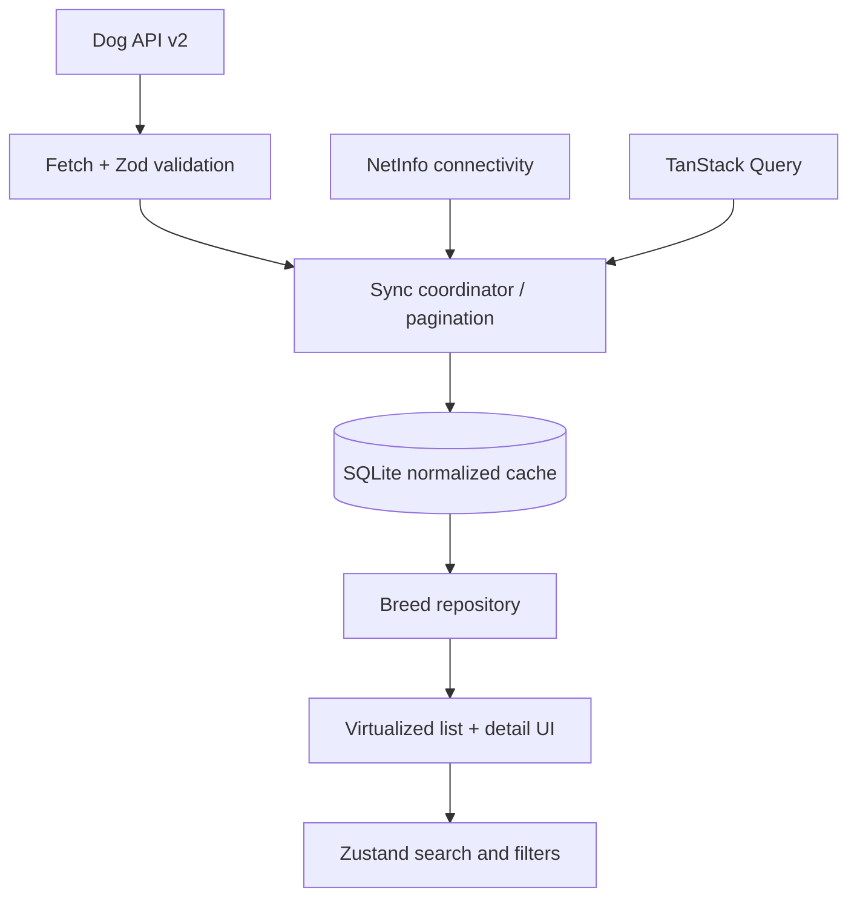

# Tripare AI — Dog Breed Explorer

An offline-first Expo + React Native + TypeScript dog-breed explorer built around Dog API v2.

> Status: architecture starter. Run the commands below, then complete the remaining UI/performance verification tasks in `docs/PERFORMANCE.md` before submitting. Do not report profiling numbers until measured on a real simulator/device.

## Quick Start

Requirements: Node.js compatible with the selected Expo SDK, npm, and Xcode (iOS) or Android Studio (Android).

```bash
npm install
cp .env.example .env
npx expo install --fix
npm run ios
# or
npm run android
```

Expo Go can be used for initial development; use a development build if a native module or configuration requires it. `npm run ios` requires macOS with Xcode. The public Dog API needs no key.

## Architecture Overview

The UI reads from a local SQLite repository first, so previously synchronized breeds can be browsed while offline. A synchronization service fetches the paginated API dataset, validates JSON:API responses at the boundary, normalizes records by stable API ID, and commits updates in a transaction. UI state such as selected filters and the search query is separate from persistent domain data.

TanStack Query coordinates request state/retry behavior, Zustand stores transient explorer preferences, and SQLite is the durable source for offline list/detail content. NetInfo detects connectivity changes and requests a sync when the device is online. Cached content is retained if a request fails; freshness and sync errors should be shown as non-blocking status messages.



## Key Technical Decisions

- **State management:** Zustand is intentionally limited to transient UI preferences (query, selected groups/size/coat/traits, theme). Remote request lifecycle is handled by TanStack Query, avoiding duplicated loading/error state.
- **Database:** Expo SQLite stores normalized breed/group records and sync metadata. Stable API IDs are primary keys; updates use upserts. A schema migration/version should be added when persisted fields change.
- **Offline sync:** Render local records immediately, then synchronize when online. Fetch pages using API pagination metadata rather than assuming a fixed page count. Use bounded concurrency, exponential backoff with jitter, and transactional writes. Never clear a valid cache because one page failed.
- **Images:** Prefer `thumb` for list rows and `medium` for detail/gallery. Let `expo-image` cache network images; persist only a small, bounded set of gallery images for offline use. Display attribution (author, license, and source URL) for each image.
- **Navigation:** Expo Router provides file-based, typed routes. Route params should use the API breed ID, not list index/name.
- **Validation:** Treat API payloads as untrusted. Validate response shapes with Zod and keep errors typed as `unknown` until narrowed.

## API

Base URL: `https://dogapi.dog/api/v2`

- `GET /breeds?page[number]=1&page[size]=48`
- `GET /breeds/{id}`
- `GET /groups?page[size]=1000`

The upstream API documents pagination in `meta.pagination` and `links`; use `meta.pagination.next` / `last` rather than relying on a hard-coded six-page assumption. The requested assessment expects 283 breeds and 9 groups, but the app should gracefully handle the live API count changing.

## Testing

```bash
npm test
npm run typecheck
```

## Screenshots and submission checklist

- [ ] Breed list in light and dark mode
- [ ] Active filters visible
- [ ] Breed details: Overview, Traits, Gallery
- [ ] Offline/stale-cache banner
- [ ] Bundle analysis captured from a release build
- [ ] Memory profiler screenshot while scrolling the complete dataset
- [ ] FPS / frame-time results from a physical device or simulator
- [ ] Critical flow E2E test (optional bonus)

See `docs/ARCHITECTURE.md`, `docs/DECISIONS.md`, and `docs/PERFORMANCE.md`.
