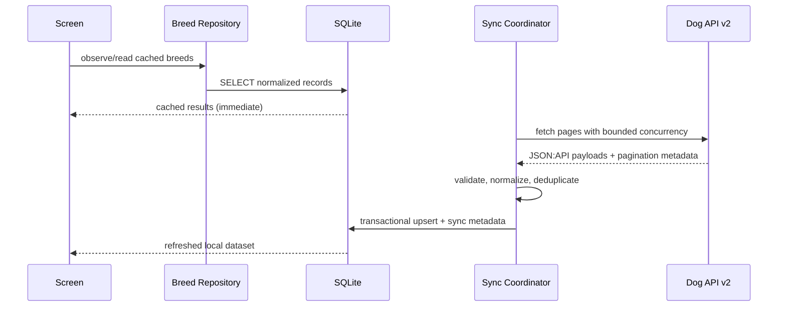

# Architecture

## Layers

1. **Presentation** — Expo Router screens, accessible controls, virtualized rows, empty/loading/error states.
2. **Feature state** — Zustand stores only UI state: search query, filter selections, selected tab, and display preferences.
3. **Application services** — sync coordinator, retry/backoff, pagination, image-cache policy, and connectivity listener.
4. **Data access** — repository interfaces and SQLite implementation. UI should not issue raw SQL.
5. **Remote boundary** — Dog API v2 fetch client, response validation, API error normalization.

## Data flow

## Failure behavior

- Offline: display cached records and last-sync time.
- One page fails: retain cache; report partial sync and retry failed page on a later sync.
- Invalid response: reject that page before writing it.
- App killed during sync: transaction rollback protects against partially committed page writes.
- Empty first launch with no network: show a useful offline-empty state and retry action.
